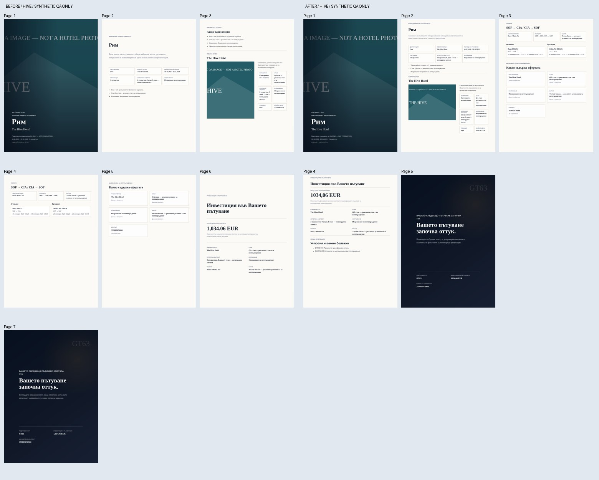
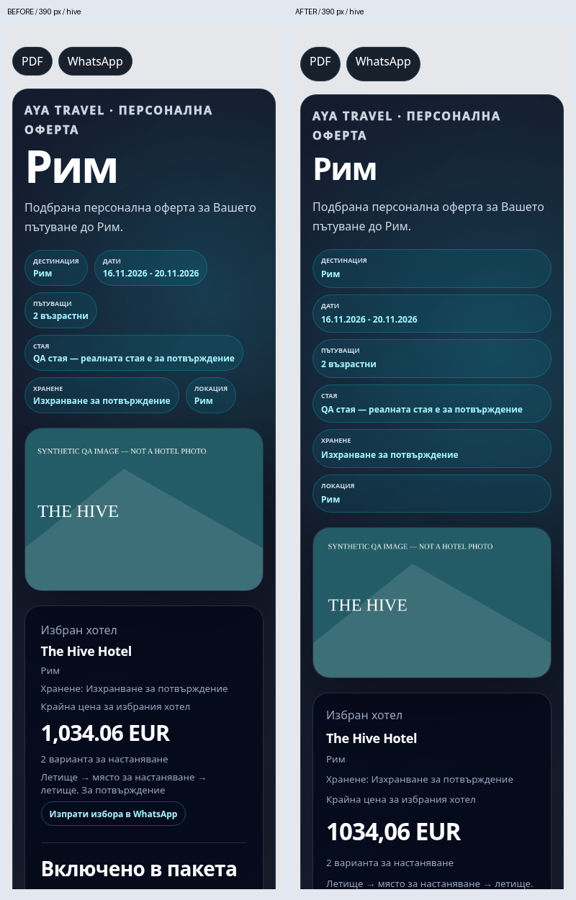
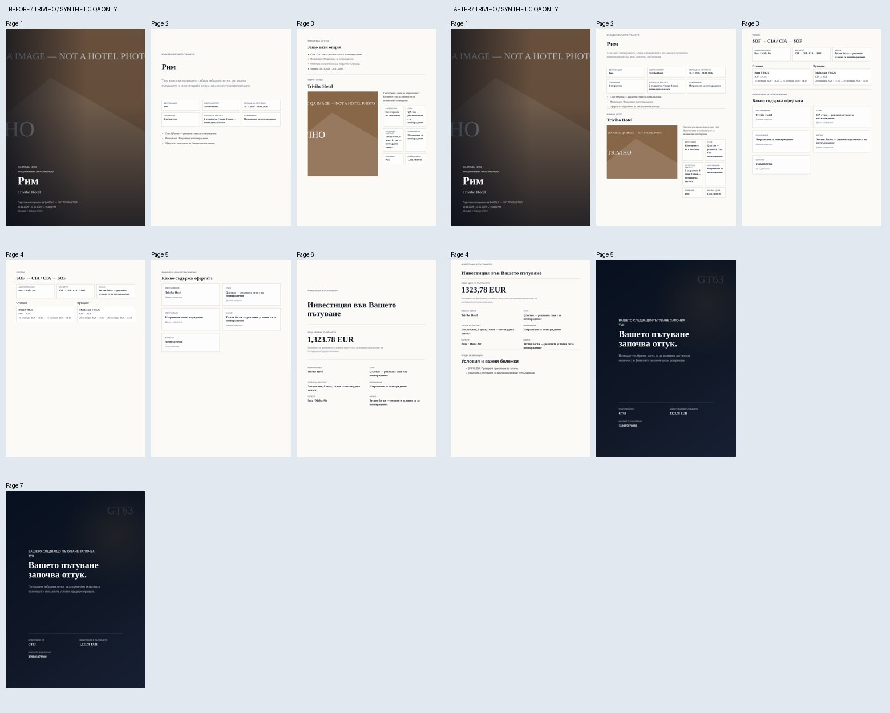
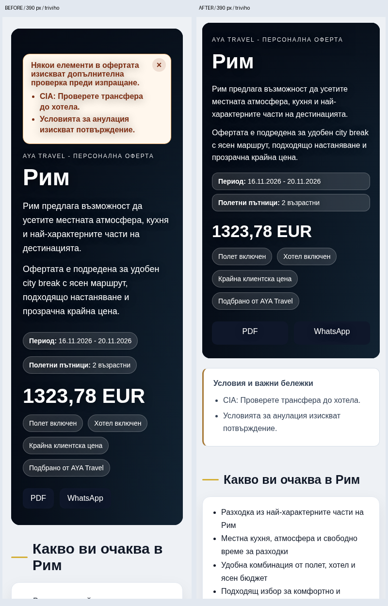
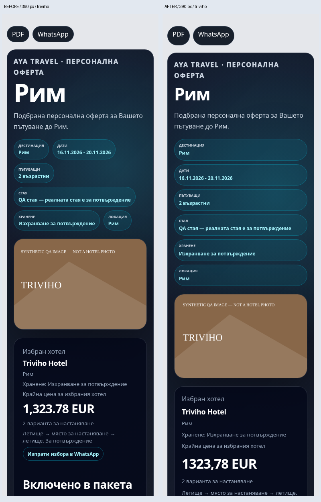

# AYA Client Presentation V2 — local review

Status: **local presentation checks PASS; real-offer acceptance PARTIAL / UNKNOWN**.
Baseline: `bf34d294715178781207e4743921f524104bbaa4` (main after PR #27).
Branch: `feat/aya-client-presentation-v2`. Node v24.22.1, Chromium/Puppeteer, Linux, 2026-11-13 UTC.

## Evidence boundary

No authenticated production snapshot/session is available in this execution environment. The reference offer `OFF-1794567326579-yl2a6` was not opened or modified. No HTML/PDF route that records client metrics was opened in production.

The local fixture copies **only the user-supplied expected totals and flight dates/times**. Hotel component prices (834.06 / 1123.78 with a synthetic 200 flight amount and zero markup), room, baggage, occupancy and images are synthetic test inputs, not recovered supplier or production data. Images visibly state **SYNTHETIC QA IMAGE — NOT A HOTEL PHOTO**. Decorative external image requests are replaced locally; no real hotel-image identity or availability claim follows from these screenshots. The actual room, meal, baggage and real hotel photos remain **UNKNOWN** pending a legitimate redacted snapshot/authenticated read-only review.

## Implementation

Reuse the existing legacy HTML renderer, shared multi-hotel renderer, shared presentation view model and print renderer. No new presentation engine.

- Narrow-screen typography, wrapping, hotel cards, image sizing, solid high-contrast card backgrounds and at least 48 px primary action styles. Tested at 360, 390 and 430 px.
- Legacy notices move outside the hero into a visible, subdued conditions section. Shared HTML and PDF retain every supplied warning and blocking condition; INFO remains a separate presentation level, not a blocking gate. Exact operator warnings are retained instead of being replaced by generic text. PDF now includes the supplied conditions/notices.
- Package summary displays the supplied baggage description rather than inferring a checked allowance from the generic word “багаж”. No flight/allowance data is changed.
- PDF groups overview with hotel details and flights with services. Removes 178 mm intro and 232 mm investment minimum heights, repeated recommendation block, and forced breaks between short sections. Portrait A4 retained; investment heading/content stays together.
- Shared currency formatting uses Bulgarian display conventions like legacy HTML. Numeric amounts, currency, markup, calculation order and overrides are unchanged. Existing expected-string tests were updated for the decimal comma, not relaxed.
- Hotel selection and PDF links continue using existing IDs and handlers. No persisted selection or other source data changes.

## Reproducible tests

All listed PASS commands exit 0:

| Command | Result |
|---|---|
| `node test/client-presentation-v2-structure-regression.js` | 5/5 PASS: notices, escaping, exact selected hotel/price/room/meal/image, missing image, supplied baggage |
| `AYA_PRESENTATION_OUTPUT=/tmp/aya-presentation-after node scripts/client-presentation-v2-regression.js` | PASS: 12 mobile states (2 render paths × 3 widths × 2 hotels), 2 real PDFs |
| `node scripts/presentation-view-model-regression.js` | PASS |
| `node scripts/offer-output-regression.js` | 8 cases PASS |
| `node scripts/final-client-renderer-registry-regression.js` | PASS |
| `node test/flight-date-resolver-regression.js` | 8/8 PASS |
| `node test/pdf-travel-period-regression.js` | PASS |
| `node scripts/v10-flight-display-bg-regression.js` | PASS |
| `git diff --check` | PASS |

The browser test binds only an ephemeral loopback server, compiles the existing application as a library with temporary data/config paths, uses no credentials, and blocks external non-image requests. Baseline capture uses the same fixture/harness against an untouched archive, with `AYA_PRESENTATION_CAPTURE_ONLY=1` to record pre-existing layout measurements; final mode enforces all assertions. No production API, notification endpoint or DB mutation is used.

Results:

| Boundary | Before | After |
|---|---:|---:|
| PDF pages, Hive | 7 | 5 |
| PDF pages, Triviho | 7 | 5 |
| Horizontal overflow, all 12 mobile states | 0 | 0 |
| Primary action targets below 44 px, each legacy state | 2 | 0 |
| Primary action targets below 44 px, each shared state | 4 | 0 |
| Broken visible controlled images | 0 | 0 |
| Raw synthetic offer mutation | none | none |

Both selected PDFs were rasterized and visually reviewed. `pdftotext -layout` independently confirmed the final PDF text contains the exact selected hotel and total (Hive **1034,06 EUR**, Triviho **1323,78 EUR**), FR625 **16 November 2026 13:25–14:15**, FR626 **20 November 2026 12:25–15:10**, and both supplied conditions. The non-selected hotel's name is absent from each selected PDF. Room/meal/baggage preservation is tested with clearly synthetic labels.

Source comparison confirms Flight-Date Safety/resolver helpers and the entire server route section after the renderer functions are byte-identical to baseline. Authorization, agency, occupancy/status gates and persistence contracts are unchanged.

## Before/after visual review

PDF sheets show all pages. Mobile comparisons show the **first 1200 px at 390 px width**, not an uncropped full-page view. Full-page captures for all widths and both choices plus PDFs and JSON measurements were generated in the execution evidence directory; regenerate with the browser command above.

### The Hive






### Triviho







## Existing failure and remaining acceptance

`node scripts/print-presentation-route-regression.js` exits **1**:

```
PRINT PRESENTATION ROUTE REGRESSION FAIL: core-route-contract: selected print route should return 200, got 422
```

This is the previously established baseline failure (also present before this work), reproduced on the corrected branch. Static assertions execute before that failure. The core-route fixture lacks root offer travelDates; its return arrival also extends beyond its sample period. Neither the fixture nor Flight-Date Safety was altered to obtain a green result. The full route/image suite is therefore **not claimed PASS**.

No production visual acceptance, real-hotel photo identity, supplier availability, actual room/meal/baggage or deployed behavior is established. Desktop/other browser engines, extreme-length itineraries and all image-cache cases are not exhaustively covered by this targeted matrix. Long descriptions remain flowable; five pages is a fixture-specific assertion, not a universal page limit.

Next gate: review the Draft PR and obtain the reference offer's actual image/room/meal/baggage fields through legitimate read-only access. Any merge/deployment requires GT63's separate approval. No merge, deployment, Railway/configuration changes or production mutations occurred.
